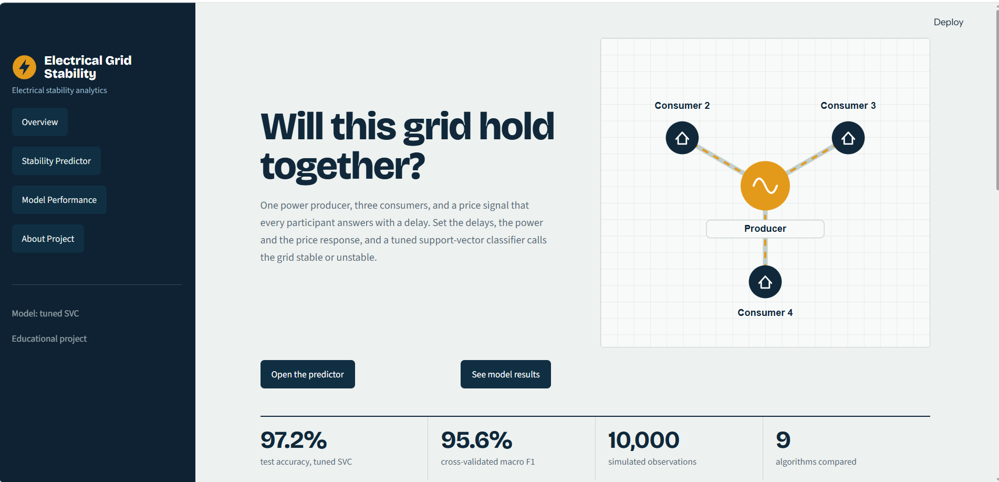
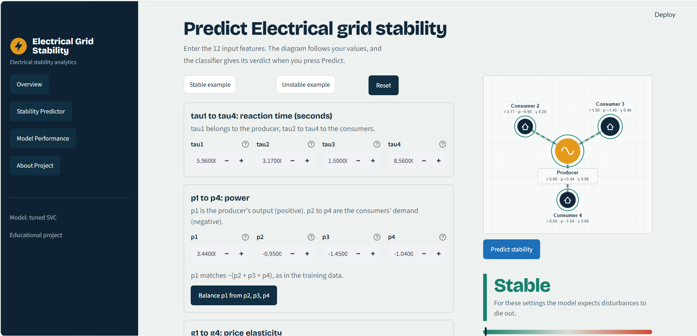
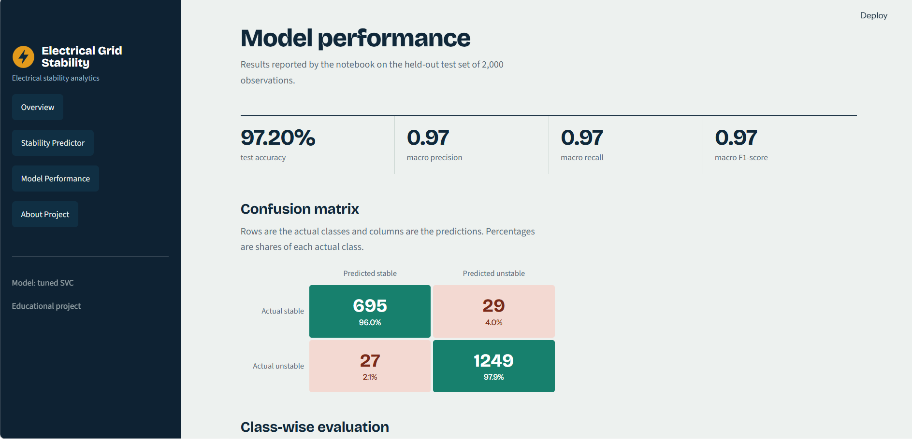
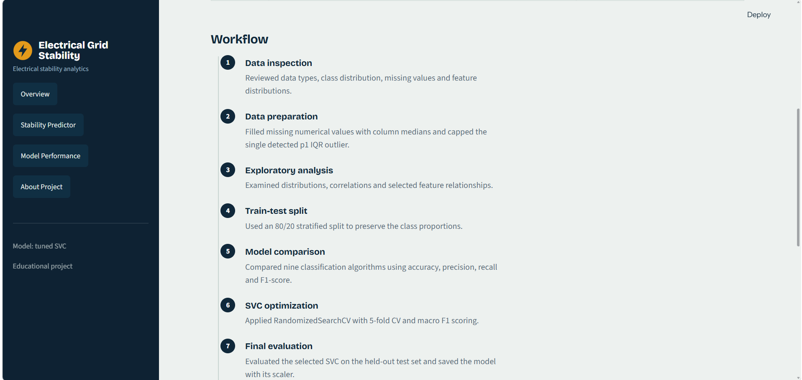

# ⚡ Electric Grid Stability Prediction

🔗 **Live App:** [https://grid-stability-jasna.streamlit.app/](https://grid-stability-jasna.streamlit.app/)

A supervised machine learning project that predicts whether a smart electrical grid is **stable** or **unstable** from 12 grid parameters. The project covers data cleaning, exploratory data analysis, a comparison of 9 algorithms, hyperparameter tuning of the best model, evaluation, and deployment as an interactive Streamlit web app.

> **Educational use only:** This project uses simulated data. It is not connected to a real power grid and must not be used for real-time grid monitoring, protection or operational decisions.

---

## 📌 Table of Contents

1. [Problem Statement](#-problem-statement)
2. [Project Highlights](#-project-highlights)
3. [Application Screenshots](#-application-screenshots)
4. [Dataset](#-dataset)
5. [Project Workflow](#-project-workflow)
6. [Exploratory Data Analysis](#-exploratory-data-analysis)
7. [Model Building and Comparison](#-model-building-and-comparison)
8. [Hyperparameter Tuning](#-hyperparameter-tuning)
9. [Final Model Evaluation](#-final-model-evaluation)
10. [Streamlit Application](#-streamlit-application)
11. [Repository Structure](#-repository-structure)
12. [Run Locally](#-run-locally)
13. [Tools and Libraries](#-tools-and-libraries)
14. [Key Learnings](#-key-learnings)
15. [Limitations](#-limitations)
16. [Acknowledgements](#-acknowledgements)

---

## 🎯 Problem Statement

In a smart grid, electricity prices change with supply and demand, and every participant (producer or consumer) reacts to those price changes **with a delay**. Some combinations of reaction times, power levels and price sensitivity make the grid settle back to normal after a disturbance. Other combinations make the disturbance grow until the system oscillates out of control.

- A grid is **stable** when a small disturbance dies out.
- A grid is **unstable** when a small disturbance keeps growing.

**Goal:** train a classifier that predicts *stable* or *unstable* from 12 grid settings, and deploy it as a web app so anyone can test different settings.

The simulated grid is a **4-node star network**: one producer (P1) at the centre supplying three consumers (C2, C3 and C4).

---

## 🌟 Project Highlights

| Item | Details |
|---|---|
| Dataset | UCI Electrical Grid Stability Simulated Data |
| Records | 10,000 |
| Task | Binary classification (`stable` / `unstable`) |
| Input features | 12 (`tau1`–`tau4`, `p1`–`p4`, `g1`–`g4`) |
| Algorithms compared | 9 |
| Best baseline | SVC, 96.35% test accuracy |
| Final model | Tuned SVC (RBF kernel, `C=10`, `gamma='auto'`) |
| **Test accuracy** | **97.20%** |
| Cross-validation macro F1 | 0.956 |
| Deployment | Streamlit Community Cloud |

---

## 🖼️ Application Screenshots

### 1. Application Overview


### 2. Stability Predictor


### 3. Model Performance


### 4. About Project


---

## 📊 Dataset

**Source:** [UCI Machine Learning Repository: Electrical Grid Stability Simulated Data](https://archive.ics.uci.edu/dataset/471/electrical+grid+stability+simulated+data)

The dataset has 10,000 simulated grid states, with 3 features for each of the 4 nodes.

| Feature group | Columns | Meaning | Range |
|---|---|---|---|
| Reaction time | `tau1`–`tau4` | How long each participant takes to respond to a price change | 0.5 to 10 s |
| Power | `p1`–`p4` | Power produced (+) or consumed (−). The producer is positive, the consumers are negative | Consumers: −0.5 to −2 |
| Price elasticity | `g1`–`g4` | How strongly each participant adjusts its power when the price moves | 0.05 to 1 |

Power balance holds in the data: `p1 = −(p2 + p3 + p4)`.

**Target:** `stabf` (`stable` / `unstable`).
**Dropped column:** `stab`, the numeric stability value from which `stabf` is derived. It was removed to avoid **target leakage**.

> The CSV file (`Electric_Grid_Stability_.csv`) is not included in this repository. Download it from the UCI link above and place it in the repository root to run the notebook.

---

## 🔄 Project Workflow

1. **Data cleaning:** dropped `stab` (target leakage), checked data types and duplicates (0 found).
2. **Missing values:** 154 missing values across the 12 features (9–18 per column) were filled with each column's **median**.
3. **Outlier handling:** checked with the 1.5 × IQR rule. Only one outlier was found (in `p1`) and it was capped at the IQR limit.
4. **Exploratory data analysis:** class counts, histograms, boxplots, correlation heatmap and scatter plots.
5. **Separate X and y:** X = the 12 input features, y = `stabf`.
6. **Train-test split:** 80:20, stratified, `random_state=42`, giving 8,000 training rows and 2,000 test rows.
7. **Encoding and scaling:** `LabelEncoder` on the target (needed for XGBoost) and `StandardScaler` fitted on the training data (for Logistic Regression, KNN and SVC).
8. **Baseline comparison:** 9 algorithms evaluated with accuracy, precision, recall and F1.
9. **Hyperparameter tuning:** `RandomizedSearchCV` on the best model (SVC).
10. **Final evaluation:** classification report and confusion matrix on the 2,000 unseen test rows.
11. **Save the model:** the tuned SVC and the fitted scaler were saved as `svc_model.sav` and `svc_scaler.sav`.
12. **Deployment:** an interactive Streamlit app that loads both files.

---

## 🔍 Exploratory Data Analysis

| Analysis | Finding |
|---|---|
| **Target distribution** | Unstable: 6,380 records (63.8%). Stable: 3,620 records (36.2%). The imbalance is moderate, and a stratified split keeps the same ratio in train and test, so SMOTE was not needed. |
| **Feature distributions** | `tau` and `g` features are spread evenly across their ranges (uniform sampling). `p2`, `p3` and `p4` are uniform between −2 and −0.5. `p1` is bell-shaped because it is the sum of the three consumers' power. No feature is heavily skewed. |
| **Outliers** | Only one outlier in the whole dataset (in `p1`). |
| **Correlation** | `p1` is negatively correlated with `p2` (−0.57), `p3` (−0.58) and `p4` (−0.58), as power balance requires. The `tau` and `g` features are close to 0 with every other feature. No pair is highly correlated, so no feature was removed. |
| **Feature relationships by class** | Stable points gather at low `tau1`: a fast-reacting producer helps stability. Classes overlap heavily in every single pair of features, so stability depends on many features together and a **non-linear model is needed**. |

---

## 🤖 Model Building and Comparison

Nine algorithms were trained as baselines and compared on the 2,000 test rows:

| Rank | Algorithm | Test accuracy (%) |
|---|---|---|
| 1 | **SVC** | **96.35** |
| 2 | XGBoost | 95.05 |
| 3 | Gradient Boosting | 93.35 |
| 4 | Random Forest | 92.40 |
| 5 | KNN | 86.35 |
| 6 | AdaBoost | 86.10 |
| 7 | Decision Tree | 84.70 |
| 8 | Gaussian Naive Bayes | 84.30 |
| 9 | Logistic Regression | 82.05 |

**Observations**
- SVC was the best baseline, with the highest weighted F1 (0.963).
- Linear models (such as Logistic Regression) scored lowest, which confirms that the decision boundary is not linear.
- Boosting models (XGBoost, Gradient Boosting) came next.

---

## 🎛️ Hyperparameter Tuning

`RandomizedSearchCV` was applied to the SVC with 5-fold cross-validation, scored by macro F1.

| Setting | Search space |
|---|---|
| `C` | 0.1, 1, 10, 100 |
| `kernel` | linear, rbf, poly |
| `gamma` | scale, auto |
| Iterations | 6 |
| CV folds | 5 |
| Scoring | `f1_macro` |

**Best parameters:** `kernel='rbf'`, `C=10`, `gamma='auto'`

| Model | Test accuracy |
|---|---|
| Baseline SVC | 96.35% |
| **Tuned SVC** | **97.20%** (+0.85 points) |

The cross-validation macro F1 (0.956) is close to the test F1 (0.97), so **overfitting is not a concern**.

---

## ✅ Final Model Evaluation

**Test accuracy: 97.20%** on 2,000 unseen rows.

| Class | Precision | Recall | F1-score | Support |
|---|---|---|---|---|
| Stable | 0.96 | 0.96 | 0.96 | 724 |
| Unstable | 0.98 | 0.98 | 0.98 | 1,276 |
| Macro avg | 0.97 | 0.97 | 0.97 | 2,000 |

Only **56 of 2,000** test rows were misclassified: 29 stable predicted as unstable, and 27 unstable predicted as stable.

---

## 🖥️ Streamlit Application

**Live app:** [https://grid-stability-jasna.streamlit.app/](https://grid-stability-jasna.streamlit.app/)

The app has four pages:

- **Overview:** the grid, what "stable" means, and the key results.
- **Stability Predictor:** enter the 12 grid settings and get a stable or unstable prediction.
- **Model Performance:** model results and evaluation.
- **About Project:** the methodology behind the project.

**How the prediction works**
1. The app loads `svc_model.sav` and `svc_scaler.sav` when it starts.
2. You enter the 12 inputs: `tau1`–`tau4`, `p1`–`p4` and `g1`–`g4`.
3. The inputs are scaled with the saved `StandardScaler`.
4. The scaled values go to the tuned SVC, and the result is shown as **Stable** or **Unstable**.

> The scaler must be saved together with the model, because the SVC was trained on scaled inputs.

---

## 📁 Repository Structure

```text
Electric-grid-stability-prediction/
├── screenshots/                              # App screenshots used in this README
├── app.py                                    # Streamlit application
├── Project_electrical_grid_stability.ipynb   # Full analysis and modelling notebook
├── svc_model.sav                             # Saved tuned SVC model
├── svc_scaler.sav                            # Saved StandardScaler
├── requirements.txt                          # Python dependencies
├── .gitignore
└── README.md
```

The model and scaler files are kept in the repository root because `app.py` loads them from the same folder as the app.

---

## 🚀 Run Locally

1. **Clone the repository**
   ```bash
   git clone https://github.com/jasnavj/Electric-grid-stability-prediction.git
   cd Electric-grid-stability-prediction
   ```

2. **Install the dependencies**
   ```bash
   pip install -r requirements.txt
   ```

3. **Start the app**
   ```bash
   streamlit run app.py
   ```

4. **(Optional) Run the notebook**
   Download `Electric_Grid_Stability_.csv` from the UCI link above, place it in the repository root, then open `Project_electrical_grid_stability.ipynb` in Jupyter.

---

## 🛠️ Tools and Libraries

- **Language:** Python
- **Data handling:** Pandas, NumPy
- **Visualization:** Matplotlib, Seaborn
- **Machine learning:** Scikit-learn, XGBoost
- **Deployment:** Streamlit, Streamlit Community Cloud
- **Version control:** Git and GitHub

---

## 💡 Key Learnings

- Dropping a column that is a direct version of the target (`stab`) prevents target leakage.
- When classes overlap heavily in every pair of features, a non-linear model such as an RBF-kernel SVC works better than a linear one.
- Scaling matters for distance-based and kernel models, and the fitted scaler must be saved and reused at prediction time.
- A small gap between cross-validation and test scores is a good sign that the model generalizes.
- Training a model is only part of the work: saving, loading and deploying it is what makes it usable.

---

## ⚠️ Limitations

- The data is **simulated** from a 4-node star grid and does not cover real-world grid complexity.
- The app is for **learning and demonstration only**. It must not be used for real-time grid monitoring, operational control or critical infrastructure decisions.
- The saved model and scaler are pickle files. Only load pickle files from sources you trust, and use the scikit-learn version pinned in `requirements.txt` so the files load correctly.

---

## 🙏 Acknowledgements

- **Dataset:** UCI Machine Learning Repository.
- Thank you to **Luminar Technolab** and my trainers **Jasmine Mam** and **Prajeesha Mam** for their guidance and support throughout this project.

---

## 👩‍💻 Author

**Jasna V J**
GitHub: [@jasnavj](https://github.com/jasnavj)

⭐ If you found this project useful, consider giving the repository a star.
